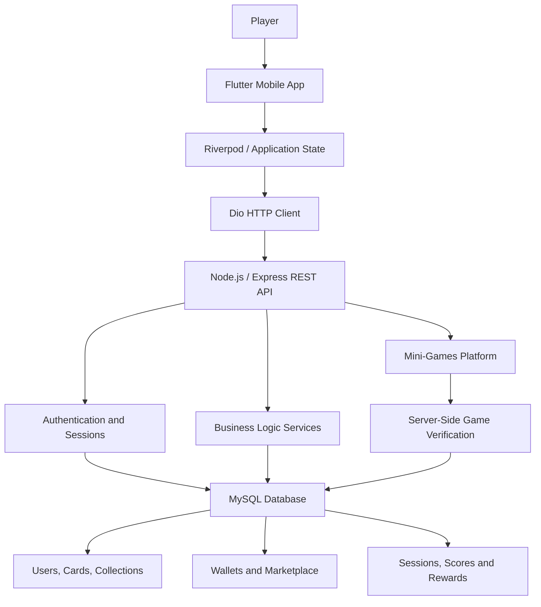

# KIRO — Collect, Play, Trade.

**A collectible card platform combining digital collections, a virtual economy, a player-driven marketplace, and server-verified mini-games.**

KIRO is a software project focused on building a secure, extensible, and engaging collectible card ecosystem. It combines a Flutter mobile application with a Node.js REST API and a relational MySQL database to manage users, collections, digital assets, marketplace transactions, rewards, and game sessions.

The project emphasizes clean separation of responsibilities, server-side validation, transactional database operations, and deterministic game verification.

  <strong>Collect Cards · Build Collections · Trade Assets · Play Mini-Games</strong>

---

## Table of Contents

- [Overview](#overview)
- [Project Goals](#project-goals)
- [Key Features](#key-features)
- [System Architecture](#system-architecture)
- [Technology Stack](#technology-stack)
- [Backend Architecture](#backend-architecture)
- [Mobile Application](#mobile-application)
- [Card Collection System](#card-collection-system)
- [Virtual Economy](#virtual-economy)
- [Marketplace](#marketplace)
- [Mini-Games Platform](#mini-games-platform)
- [Security and Data Integrity](#security-and-data-integrity)
- [Database Design](#database-design)
- [Localization and UI](#localization-and-ui)
- [Deployment and Monitoring](#deployment-and-monitoring)
- [Development Principles](#development-principles)
- [Project Status](#project-status)
- [Future Improvements](#future-improvements)
- [Author](#author)

---

## Overview

KIRO is designed around a digital collectible economy in which players acquire cards, complete collections, earn virtual currency, trade cards with other players, and participate in mini-games.

Rather than treating the application as a simple card collection interface, KIRO approaches the problem as a connected software ecosystem. The mobile application provides the player experience, while the backend is responsible for authentication, business rules, asset ownership, economic transactions, reward validation, and game result verification.

The project brings together several areas of software engineering:

- **Mobile development:** Building a responsive cross-platform application with Flutter and Dart.
- **Backend development:** Designing RESTful APIs with Node.js and Express.js.
- **Database engineering:** Modeling relational data and implementing transactional operations with MySQL and Knex.js.
- **Game systems:** Developing game logic, deterministic random generation, scoring, and server-side verification.
- **Security:** Managing authentication, sessions, authorization, and validation of sensitive operations.
- **Application architecture:** Separating UI, API, business logic, database access, and game-specific logic into maintainable components.

KIRO is developed with an emphasis on understanding and implementing the underlying systems rather than relying entirely on automated code generation.

## Project Goals

The main goals of KIRO are:

1. Build a complete collectible card experience with persistent user collections and rarity-based assets.
2. Create a virtual economy with clearly separated currencies and controlled reward generation.
3. Implement a marketplace with secure ownership checks and reliable transactions.
4. Develop mini-games that integrate with the main economy without trusting client-submitted scores.
5. Establish a modular architecture that supports new cards, games, rewards, and features.
6. Deliver an accessible interface with multilingual support.
7. Apply practical software engineering principles across mobile, backend, database, and deployment layers.

---

## Key Features

### User Accounts and Authentication

KIRO includes an authentication and session-management system designed to support secure access to player accounts.

The authentication architecture includes:

- User registration and login.
- Password-based authentication.
- Session and refresh-token management.
- Account-specific application data loading.
- Authentication and authorization middleware.
- Failed-login rate limiting and temporary lockout policies.
- Account deletion workflows with a grace period.
- Integration points for external identity providers.

The application also supports an account initialization flow that determines which screen a user should see based on their account state, such as avatar selection or the main application interface.

### Daily Card Pack

The Free Daily Pack is a recurring reward mechanic that allows players to acquire a card without purchasing it.

The intended system includes:

- An eight-hour cooldown.
- Server-controlled card selection and reward calculation.
- Rarity-weighted card distribution.
- Automatic inventory updates.
- Gem rewards determined by card rarity.
- Persistent claim history and cooldown enforcement.

The reward logic is handled by the backend to prevent clients from independently determining card drops or modifying their rewards.

### Card Collections

Players can collect cards of different rarities and progress toward collection milestones.

The collection system is designed to support:

- Individual card ownership.
- Duplicate card management.
- Collection completion tracking.
- Rarity-based progression.
- Collection reward milestones.
- Exclusive cosmetic rewards for completing a collection.

### Marketplace

The marketplace allows players to list eligible cards for sale and purchase cards listed by other players.

Its architecture includes:

- Browsing available listings.
- Managing personal listings.
- Listing and purchasing cards.
- Recording trade history.
- Applying marketplace transaction fees.
- Reserving cards listed for sale.
- Preventing protected collection copies from being sold.
- Database transactions and row-level locking for sensitive operations.

### Card Burning

Card burning provides a mechanism for removing duplicate cards from a player's inventory in exchange for a portion of their reference value.

The system is designed around configurable rules, including a minimum quantity requirement, a protected copy of each card, and a configurable reward rate.

Burn operations are intended to update ownership and grant rewards atomically, preserving the integrity of the card economy.

### Mini-Games

KIRO includes a modular mini-games platform that connects gameplay to the wider virtual economy.

The platform is designed to support:

- Game registration and activation.
- Game-specific configuration.
- Server-created game sessions.
- Seeded random generation where applicable.
- Score verification.
- Daily play statistics.
- Best-score tracking.
- Reward thresholds.
- Daily reward caps.
- Configurable advertising requirements for eligible games.

The initial game implementations include a block puzzle and a Match-3 puzzle, with each game maintaining its own rules and gameplay logic while sharing common backend infrastructure.

---

## System Architecture

KIRO follows a client-server architecture. The Flutter application handles presentation and player interactions, while the backend enforces application rules and manages persistent state.

### Architecture Responsibilities

| Layer | Responsibility |
|---|---|
| Flutter UI | Screens, widgets, animations, and player interactions |
| State management | Application state, loading states, and UI updates |
| API client | HTTP communication and API response handling |
| REST API | Routing, request validation, authentication, and error handling |
| Business services | Application rules, economy operations, and transaction coordination |
| Game services | Session lifecycle, score verification, and reward calculation |
| Database layer | Relational persistence, constraints, and transactional consistency |
| MySQL | Durable storage of users, cards, inventory, listings, and game records |

The architecture separates presentation from business rules so that sensitive operations remain under backend control.

---

## Technology Stack

### Backend

| Technology | Purpose |
|---|---|
| Node.js | Server-side JavaScript runtime |
| Express.js | REST API and middleware |
| JavaScript | Backend application logic |
| MySQL | Relational database |
| Knex.js | SQL query building and database access |
| Sentry | Backend error monitoring |

### Mobile Application

| Technology | Purpose |
|---|---|
| Flutter | Cross-platform application development |
| Dart | Mobile application programming language |
| Riverpod | Application state management |
| ChangeNotifier | Observable state and UI updates where appropriate |
| Dio | HTTP client and API communication |
| go_router | Navigation and route management |
| Sentry | Error monitoring and diagnostics where integrated |

### Desktop Development Experience

Java and JavaFX, alongside Java Swing, are also part of the developer's software development experience. They are separate from the primary KIRO mobile and backend architecture.

### Infrastructure and Tools

- Git and GitHub for version control and source code management.
- Render for backend deployment.
- MySQL-compatible database infrastructure.
- BlueStacks for Android application testing.
- Sentry for backend monitoring and error diagnosis.

The exact deployment configuration and integration status of individual services may vary by environment.

---

## Backend Architecture

The backend is responsible for the authoritative state of the KIRO ecosystem.

Its responsibilities extend beyond serving data to the mobile application. It enforces business rules, coordinates database changes, validates ownership, manages game sessions, and determines which rewards players can receive.

### REST API

The API provides the communication layer between the mobile application and backend services.

Its responsibilities include:

- Handling HTTP requests and responses.
- Validating request data.
- Applying authentication and authorization.
- Calling application services.
- Returning structured responses.
- Handling errors consistently.
- Protecting sensitive endpoints with appropriate middleware.

### Service Layer

Business operations are separated from route handlers wherever appropriate.

For example, a marketplace purchase is not merely an API endpoint that changes a balance. It is a business operation involving ownership validation, listing validation, currency checks, fee calculation, and multiple related database updates.

Keeping these responsibilities in a service layer makes the logic easier to maintain, test, and extend.

### Database Access

Knex.js provides a structured way to build SQL queries and coordinate database operations.

The database layer supports relational data access and transactional workflows, including operations that must update several records together.

### Centralized Error Handling

The backend uses centralized error handling to maintain consistent API behavior and improve diagnostics.

Errors are processed through the API's error-handling infrastructure, with monitoring integration used to investigate unexpected failures where configured.

---

## Mobile Application

The KIRO mobile application is built with Flutter and Dart.

Its purpose is to present the collectible ecosystem through a unified interface while communicating with the backend through HTTP APIs.

### State Management

Riverpod and ChangeNotifier are used where appropriate to manage application state and update the interface when data changes.

The application separates user interactions from network operations and persistent backend state.

### API Communication

Dio provides the HTTP communication layer.

This allows application features to request user data, load collections, retrieve marketplace listings, claim rewards, and interact with mini-game endpoints through the backend API.

### Navigation

The application uses go_router for navigation between screens and for managing route transitions based on the current application flow.

### Interface Design

KIRO uses a fantasy-inspired visual identity built around collectible cards, ornate frames, rarity distinctions, and a dark purple aesthetic.

The interface is designed to provide a consistent experience across the main application, collection screens, marketplace, profile, and mini-games.

### Audio and Gameplay Feedback

The mini-games include dedicated audio integration for background music and gameplay sound effects, using shared audio-management services where applicable.

Gameplay interfaces also incorporate animations and visual feedback to make moves, matches, clears, and rewards easier to understand.

---

## Card Collection System

Cards are the central collectible assets in KIRO.

Each card has its own identity and rarity, and the backend maintains the authoritative relationship between cards and player inventories.

### Card Rarities

The current economy design defines five rarity levels:

| Rarity | Role |
|---|---|
| Common | The most frequently obtained cards |
| Rare | A less frequent collection tier |
| Epic | A higher-value collectible tier |
| Legendary | A scarce and valuable tier |
| Royal | The highest rarity tier |

Rarity influences card distribution, market valuation, and the number of Gems granted by the daily pack.

### Collection Progression

Collection progress is based on the cards owned by a player and the requirements of each collection.

The planned collection milestone structure includes:

- 25% completion.
- 50% completion.
- 75% completion.
- 100% completion.

Progress rewards are intended to encourage continued collection, with a special avatar associated with full completion.

### Duplicate Management

Duplicate cards can contribute to the economy through marketplace sales or card burning, subject to the relevant ownership and inventory rules.

The system is designed to preserve at least one copy for collection purposes and to account for cards already reserved by marketplace listings.

---

## Virtual Economy

KIRO uses two distinct virtual currencies: **Gems** and **Gold (Coins)**.

Keeping the currencies separate gives them different purposes and allows their supply and rewards to be balanced independently.

### Gems

Gems are the primary currency for the collectible economy.

They are designed to support:

- Purchasing cards through the marketplace.
- Receiving rewards from card acquisition.
- Participating in eligible reward mechanics.
- Receiving rewards from mini-games.
- Other collectible-related operations as the economy expands.

### Gold / Coins

Gold, also referred to as Coins in the application, is intended for cosmetic progression.

Its planned uses include:

- Purchasing avatars.
- Unlocking cosmetic content.
- Supporting other non-card cosmetic features.

The intended separation means Gold and Gems do not serve as interchangeable currencies.

### Economy Design

The economy uses configurable rewards, rarity-based values, marketplace fees, and daily reward limits to control progression.

The current design includes the following reference values:

| Card Rarity | Daily Pack Gem Reward |
|---|---:|
| Common | 8 |
| Rare | 25 |
| Epic | 80 |
| Legendary | 250 |
| Royal | 1,000 |

These values describe the current design configuration and may change during balancing.

The economy is designed to avoid uncontrolled reward generation by enforcing cooldowns, transaction rules, and daily reward limits on the backend.

---

## Marketplace

The marketplace is a core part of the KIRO economy, connecting card ownership with player-to-player trading.

### Listing and Ownership Rules

Before a card can be listed, the backend must verify that the player owns enough eligible copies.

The inventory calculation accounts for:

- Total owned copies.
- Copies reserved by active listings.
- A protected copy retained for the player's collection.

This prevents a player from listing more cards than they can legitimately sell.

### Purchasing Workflow

A purchase requires several checks:

1. Confirm that the listing exists and is available.
2. Verify that the buyer is authorized to perform the operation.
3. Confirm that the buyer has sufficient Gems.
4. Validate the listing price and applicable fee.
5. Lock or otherwise protect the relevant database records against conflicting transactions.
6. Transfer the card and update the relevant balances.
7. Record the completed transaction.

The operation should be atomic: if a required step fails, the database must not be left in a partially updated state.

### Marketplace Fee

The current design uses a 10% marketplace transaction fee.

This fee is applied by the backend rather than trusted to a value calculated by the client.

### Trading History

Trade history provides a record of completed marketplace transactions and supports transparency for buyers and sellers.

The marketplace architecture is intended to remain extensible as additional trading features are introduced.

---

## Mini-Games Platform

KIRO's mini-games platform is designed as a reusable system rather than a collection of unrelated game implementations.

A shared backend manages game registration, sessions, daily statistics, reward policies, and verification, while individual games define their own rules.

### Game Registry

The game registry provides a central mechanism for identifying available games and connecting each game to its implementation.

Game configuration can define properties such as:

- Board dimensions.
- Difficulty.
- Scoring parameters.
- Daily Gem limits.
- Required advertising entries where applicable.
- Game-specific configuration values.

This approach allows new games to be integrated without duplicating the entire session and reward infrastructure.

### Game Sessions

The backend creates game sessions and associates them with the relevant player and game.

A session can include a unique identifier, a seed for deterministic gameplay where supported, and the initial game state needed by the client.

The client uses this information to initialize its gameplay logic.

### Server-Side Verification

The mobile client is responsible for displaying gameplay and collecting player input. It is not the final authority for reward eligibility.

The backend verifies submitted gameplay information according to the rules of the relevant game.

Where deterministic verification is implemented, the server can reproduce game-state transitions from the session's initial conditions and recorded moves.

This helps prevent modified clients from submitting arbitrary scores or inventing rewards.

### Daily Rewards and Best Scores

The shared game system tracks daily statistics, including play counts, best scores, and Gems earned.

Reward thresholds can be configured so that players earn rewards for reaching qualifying scores, while previously achieved thresholds and daily caps restrict repeated reward generation.

Game completion and reward granting are coordinated through backend logic and database transactions.

### KIRO Blocks

KIRO Blocks is a block-placement puzzle inspired by grid-based puzzle games.

Its gameplay implementation includes:

- A grid-based board.
- Polyomino pieces containing different arrangements of cells.
- Piece rotation without mirroring.
- Piece placement and move history.
- Line clearing and combo feedback.
- Score calculation.
- Game-over handling.
- Gameplay audio and visual effects.

The backend game integration is designed to validate the submitted move history and calculate eligible rewards according to the configured game rules.

### KIRO Match-3

KIRO Match-3 is a tile-matching puzzle in which players swap adjacent tiles to create matching groups.

The game architecture includes:

- A grid-based board.
- Multiple tile types.
- Match detection.
- Tile swapping.
- Cascading matches.
- Special tile creation and activation.
- Score and combo tracking.
- Move history.
- Seeded random generation for deterministic verification where implemented.

The planned special-tile mechanics include striped tiles, wrapped tiles, and color bombs.

The backend and mobile implementations must agree on the game rules and deterministic state transitions for reliable replay verification.

### Reward Integrity

The mini-games platform is designed around three important principles:

1. **The server owns reward decisions.**
2. **Client-submitted gameplay data must be validated.**
3. **Daily limits and reward history must be enforced persistently.**

These principles help ensure that gameplay rewards remain consistent with the wider KIRO economy.

---

## Security and Data Integrity

Security is an important part of KIRO's architecture, particularly because the application manages virtual currency, collectible ownership, and reward-bearing game sessions.

### Authentication and Sessions

The authentication system includes configurable protections for failed login attempts, session management, and account-related workflows.

The current backend design includes a failed-login threshold of five attempts within a 15-minute window, a temporary lockout policy, refresh-token handling, and a 30-day account-deletion grace period.

These values describe the current design and should be verified against the active deployment configuration.

### Server-Side Validation

Sensitive operations must be validated by the backend.

Examples include:

- Claiming a daily pack.
- Updating virtual currency balances.
- Creating marketplace listings.
- Purchasing cards.
- Burning cards.
- Completing mini-games.
- Granting game rewards.

The client must not be trusted to determine its own currency balance, card ownership, marketplace fee, or final reward.

### Database Transactions

Transactions are used where multiple related changes must succeed or fail together.

Marketplace operations and reward-granting workflows are examples of operations that benefit from transactional consistency.

### Concurrency Protection

Concurrent requests can otherwise cause duplicate purchases, oversold cards, or repeated reward claims.

KIRO's marketplace design uses database row locking and inventory reservation rules to protect sensitive operations.

### Input Validation and Error Handling

Requests should be validated before sensitive business logic is executed.

Centralized error handling and monitoring help identify unexpected behavior without relying solely on client-side diagnostics.

### Security Scope

These measures form part of the project's security design. They do not, by themselves, constitute a formal security audit or guarantee that every possible attack has been eliminated.

---

## Database Design

KIRO uses MySQL as its relational data store, with Knex.js providing structured database access.

The schema is organized around the main entities and workflows of the application.

### Main Data Domains

| Domain | Purpose |
|---|---|
| Users | Player accounts and profile-related information |
| Authentication | Session and authentication-related records |
| Cards | Card definitions, rarities, and reference values |
| Inventory | Player-owned cards and quantities |
| Collections | Collection definitions and completion progress |
| Marketplace | Listings, reservations, and trade history |
| Rewards | Reward definitions and reward-related configuration |
| Games | Available mini-games and their configurations |
| Game sessions | Session identifiers and game-specific state |
| Game rewards | Reward thresholds and associated reward rules |
| Daily game statistics | Daily play counts, best scores, and earned rewards |
| Settings | Configurable application and economy rules |

The exact table names and relationships depend on the active database migrations.

### Data Integrity Principles

The database design emphasizes:

- Explicit relationships between entities.
- Consistent ownership records.
- Persistent reward and transaction history.
- Transactional updates for sensitive operations.
- Configurable rules instead of unnecessary hard-coded business values.
- Server-side enforcement of inventory and currency constraints.

This relational foundation supports future expansion without requiring every feature to implement its own independent persistence model.

---

## Localization and UI

KIRO is designed with multilingual support in mind.

The current localization work includes:

- English.
- French.
- Arabic.

Arabic support requires attention to right-to-left layout behavior, text alignment, and screen composition.

The application also uses a consistent fantasy-inspired visual style across collectible cards, the marketplace, collections, profile screens, and mini-games.

The goal is to make the interface feel like one cohesive product rather than a collection of unrelated screens.

---

## Deployment and Monitoring

KIRO separates the mobile client from the backend deployment environment.

The Flutter application communicates with the deployed API through its configured base URL. The backend connects to the configured MySQL database and exposes the REST endpoints required by the client.

### Backend Deployment

Render has been used for backend deployment.

The deployment process must account for environment-specific configuration, database connectivity, authentication secrets, and API availability.

### Error Monitoring

Sentry is integrated into the backend development workflow for error monitoring and diagnosis.

Monitoring is intended to make unexpected server errors easier to investigate and to improve the reliability of the application as its complexity grows.

### Environment Configuration

Sensitive values should be provided through environment variables or the relevant deployment secret-management mechanism.

Examples include:

- Database connection credentials.
- Authentication secrets.
- Token-signing configuration.
- External service credentials.
- Environment-specific API configuration.

Secrets and production credentials should never be committed to the repository.

---

## Development Principles

KIRO is developed with an emphasis on maintainability, correctness, and a practical understanding of the systems involved.

The main principles include:

### Separation of Concerns

Presentation, state management, HTTP communication, backend business logic, and persistence have distinct responsibilities.

### Backend Authority

The server is responsible for validating sensitive actions and maintaining the authoritative state of the economy.

### Transactional Consistency

Operations involving multiple related records should be atomic whenever required by the business rules.

### Reusable Infrastructure

Shared systems, such as authentication middleware, error handling, database access, game sessions, and reward calculation, are designed to support multiple features.

### Configurable Business Rules

Economy settings, reward thresholds, and game parameters should be configurable where appropriate to make balancing and future changes easier.

### Incremental Development

Features are developed in stages, with attention to database design, backend logic, mobile integration, and testing rather than treating the user interface as the entire feature.

---

## Project Status

KIRO is an actively developed software project.

The project has progressed through database design, backend implementation, Flutter application development, and the integration of interconnected systems.

The following areas represent the main development scope:

- User authentication and session management.
- Card and collection systems.
- Virtual currency and reward rules.
- Marketplace listing and transaction logic.
- A reusable mini-games backend.
- Block puzzle gameplay.
- Match-3 gameplay.
- Mobile navigation, state management, and API integration.
- Deployment and error monitoring.

The implementation status of individual screens, endpoints, integrations, and game-verification rules may differ. Features described as designed or supported by the architecture should not be assumed to be publicly released or fully production-ready without verification.

The current focus is on improving gameplay correctness, backend validation, integration reliability, and the overall user experience.

---

## Future Improvements

Potential areas for continued development include:

- Completing and validating end-to-end mini-game verification.
- Expanding the collection of original collectible cards.
- Improving marketplace usability and transaction observability.
- Expanding automated testing for business-critical operations.
- Improving application performance and error recovery.
- Refining economy balancing using gameplay and reward data.
- Expanding the mini-games platform with additional game implementations.
- Improving deployment resilience and monitoring.
- Evaluating future monetization features and optional premium functionality.
- Exploring physical-card or QR-based integrations as a separate future extension.

These are development directions, not a claim that every feature is currently available.

---

## Author

**Baha Ilyes**  
Software Developer | Backend, Mobile, and Desktop Development

- **GitHub:** [@ilyesbsoft-creator](https://github.com/ilyesbsoft-creator)
- **Repository:** [KIRO](https://github.com/ilyesbsoft-creator/KIRO)
- **Email:** ilyes.bsoft@gmail.com

KIRO is a practical software engineering project that brings together backend development, mobile application architecture, relational database design, digital economies, and game systems.

---

  <strong>KIRO — Collect. Play. Trade.</strong>

